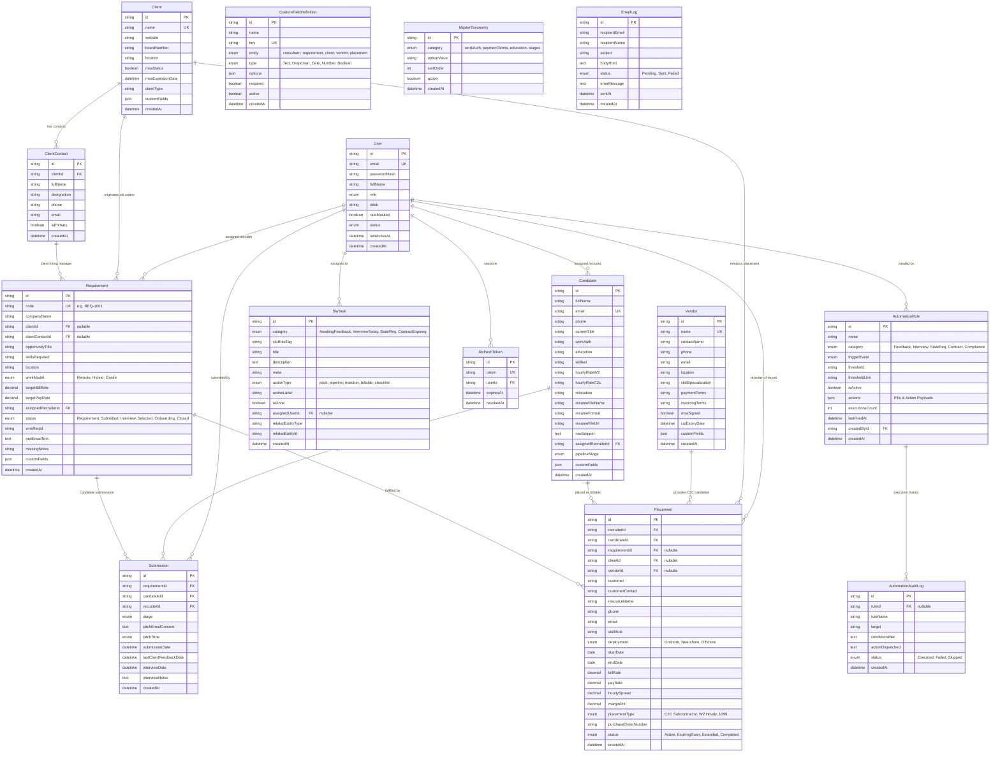

# TalentOS — Database Architecture & Schema Specification

This document provides the complete PostgreSQL database design for **TalentOS**, modeled directly from the recruitment CRM platform prototype. It includes a comprehensive Mermaid Entity-Relationship (ER) diagram, detailed entity descriptions, and the complete, production-ready `schema.prisma` file.

---

## 1. Entity-Relationship Diagram (Mermaid)



---

## 2. Entity Descriptions & Business Logic Rules

### 2.1 User & Team Administration
- **Rate Masking (`rateMasked`)**: When `true`, the user cannot view bill rates, pay rates, or margin spread figures on consultants or placements. The API response transforms `$115/hr` into `••••••` or `[Masked]` unless the user is an Administrator or Senior Recruiter with rate clearance.
- **Roles**:
  - `ADMINISTRATOR`: Full permissions, user provisioning, rule customization, financial access.
  - `SENIOR_RECRUITER`: Full pipeline, submittals, client billing views, SLA actions.
  - `TECHNICAL_RECRUITER`: Sourcing, candidate management, resume parsing; financial rates masked by default.
  - `BENCH_SALES_LEAD`: Bench marketing, vendor submittals, rate visibility for bench placement.
  - `ACCOUNT_EXECUTIVE`: Client accounts, MSA contracts, requirement intake.
  - `ASSOCIATE_RECRUITER`: Junior sourcing queue, candidate outreach.

### 2.2 Candidates & Consultants
- Represents both bench candidates and active applicants.
- Key properties extracted automatically by the Python NLP parser: `fullName`, `phone`, `email`, `workAuth`, `education`, `skillset`, `currentTitle`.
- Supports dual rates: `hourlyRateW2` and `hourlyRateC2c`.
- `customFields`: Dynamic JSON object adhering to active `CustomFieldDefinition` rules.

### 2.3 Clients & Contacts
- Represents end-clients (e.g. *Pfizer, Goldman Sachs, Capital One*).
- 1-to-Many relation with `ClientContact` (VP of Infrastructure, Engineering Director, CISO).
- Tracks corporate MSA status and expiration dates for SLA alerting.

### 2.4 Vendors (Staffing Subcontractors)
- Represents partner agencies providing third-party C2C candidates.
- Tracks `paymentTerms` (Net 30, Net 45), `invoicingTerms` (Bi-weekly), `msaSigned`, and `coiExpiryDate` (Certificate of Insurance).

### 2.5 Requirements & Job Orders
- Created manually or ingested via the **Email Intake Parser**.
- Tracks target bill/pay rates and status workflow: `Requirement` &rarr; `Submitted` &rarr; `Interview` &rarr; `Selected` &rarr; `Onboarding` &rarr; `Closed`.
- Inactive Req SLA: Triggers alert when a job has 0 submissions after 5 days.

### 2.6 Submissions & Recruitment Pipeline
- Connects a Candidate to a Requirement with recruiter attribution.
- Stores pitch email drafts and the selected tone (`Professional`, `High-Impact`, `Technical Focus`).
- Tracks feedback SLAs: If client feedback is pending > 48 hours, an alert task is automatically generated in the recruiter's SLA priority queue.

### 2.7 Placements & Commercial Spread Ledger
- Activated either manually or through the **1-Click Placement Wizard** when a candidate transitions to `Onboarding`.
- Automated Financial Calculations:
  $$\text{Hourly Spread} = \text{Bill Rate} - \text{Pay Rate}$$
  $$\text{Margin \%} = \left(\frac{\text{Hourly Spread}}{\text{Bill Rate}}\right) \times 100$$
  $$\text{Monthly Gross Profit} = \text{Hourly Spread} \times 160\text{ hours}$$
- Contract Expiry Radar: Automatically detects when `endDate` is within 30 days and flags the placement for SOW extension or bench redeployment.

### 2.8 SLA Tasks & Automations Engine
- `SlaTask`: Actionable daily reminders evaluated continuously via deterministic rules.
- `AutomationRule` & `AutomationAuditLog`: Configurable rules with triggers (`feedback_delayed`, `interview_today`, `stale_req`, `contract_ending`, `visa_expiring`), condition thresholds, and actions (recruiter task, SMTP notification email, manager alert).

---

## 3. Complete `schema.prisma`

```prisma
// ==============================================================================
// TalentOS Prisma Schema — PostgreSQL
// ==============================================================================

generator client {
  provider = "prisma-client-js"
}

datasource db {
  provider = "postgresql"
  url      = env("DATABASE_URL")
}

// ------------------------------------------------------------------------------
// Enums
// ------------------------------------------------------------------------------

enum UserRole {
  ADMINISTRATOR
  SENIOR_RECRUITER
  TECHNICAL_RECRUITER
  BENCH_SALES_LEAD
  ACCOUNT_EXECUTIVE
  ASSOCIATE_RECRUITER
}

enum UserStatus {
  ACTIVE
  SUSPENDED
  INVITED
}

enum CandidatePipelineStage {
  AVAILABLE_BENCH
  SUBMITTED
  INTERVIEW
  SELECTED
  ONBOARDING
  BILLABLE
  ARCHIVED
}

enum RequirementStatus {
  REQUIREMENT
  SUBMITTED
  INTERVIEW
  SELECTED
  ONBOARDING
  CLOSED
}

enum WorkModel {
  REMOTE
  HYBRID
  ONSITE
}

enum DeploymentType {
  ONSHORE
  NEARSHORE
  OFFSHORE
}

enum PlacementType {
  C2C_SUBCONTRACTOR
  W2_HOURLY
  TEN_NINETY_NINE
  FULL_TIME
}

enum PlacementStatus {
  ACTIVE
  EXPIRING_SOON
  EXTENDED
  COMPLETED
  TERMINATED
}

enum PitchTone {
  PROFESSIONAL
  HIGH_IMPACT
  TECHNICAL_FOCUS
}

enum AutomationCategory {
  FEEDBACK
  INTERVIEW
  STALE_REQ
  CONTRACT
  COMPLIANCE
  CUSTOM
}

enum TriggerEvent {
  FEEDBACK_DELAYED
  INTERVIEW_TODAY
  STALE_REQ
  CONTRACT_ENDING
  VISA_EXPIRING
  HIGH_MARGIN
  CUSTOM
}

enum AuditStatus {
  EXECUTED
  FAILED
  SKIPPED
}

enum SlaCategory {
  AWAITING_FEEDBACK
  INTERVIEW_TODAY
  STALE_REQUIREMENT
  CONTRACT_EXPIRING
  COMPLIANCE_ALERT
}

enum SlaActionType {
  PITCH
  PIPELINE
  MATCHER
  BILLABLE
  CHECKLIST
}

enum CustomFieldEntityType {
  CONSULTANT
  REQUIREMENT
  CLIENT
  VENDOR
  PLACEMENT
}

enum CustomFieldType {
  TEXT
  DROPDOWN
  DATE
  NUMBER
  BOOLEAN
}

enum MasterTaxonomyCategory {
  WORK_AUTH
  PAYMENT_TERMS
  EDUCATION
  STAGES
}

enum EmailStatus {
  PENDING
  SENT
  FAILED
}

// ------------------------------------------------------------------------------
// 1. User & Authentication Models
// ------------------------------------------------------------------------------

model User {
  id              String         @id @default(uuid())
  email           String         @unique
  passwordHash    String
  fullName        String
  role            UserRole       @default(TECHNICAL_RECRUITER)
  desk            String         @default("US IT Contract (C2C & W2)")
  rateMasked      Boolean        @default(true)
  status          UserStatus     @default(ACTIVE)
  workload        String?        @default("0 Requisitions • 0 Submissions")
  lastActiveAt    DateTime?
  createdAt       DateTime       @default(now())
  updatedAt       DateTime       @updatedAt

  refreshTokens   RefreshToken[]
  candidates      Candidate[]    @relation("RecruiterCandidates")
  requirements    Requirement[]  @relation("RecruiterRequirements")
  submissions     Submission[]   @relation("RecruiterSubmissions")
  placements      Placement[]    @relation("RecruiterPlacements")
  slaTasks        SlaTask[]      @relation("AssignedSlaTasks")
  rulesCreated    AutomationRule[] @relation("UserCreatedRules")

  @@index([email])
  @@index([role])
}

model RefreshToken {
  id          String    @id @default(uuid())
  token       String    @unique
  userId      String
  user        User      @relation(fields: [userId], references: [id], onDelete: Cascade)
  expiresAt   DateTime
  revokedAt   DateTime?
  createdAt   DateTime  @default(now())

  @@index([token])
  @@index([userId])
}

// ------------------------------------------------------------------------------
// 2. Candidate & Consultant Directory
// ------------------------------------------------------------------------------

model Candidate {
  id                 String                 @id @default(uuid())
  fullName           String
  email              String                 @unique
  phone              String?
  currentTitle       String
  workAuth           String                 // e.g. "US Citizen", "H-1B", "Green Card"
  education          String?
  skillset           String                 // Comma-separated or tag search index
  hourlyRateW2       Decimal?               @db.Decimal(10, 2)
  hourlyRateC2c      Decimal?               @db.Decimal(10, 2)
  hourlyRateDisplay  String?                // e.g. "$90/hr (W2)"
  relocation         String                 @default("Yes")
  resumeFileName     String?
  resumeFormat       String?                // e.g. "PDF (3 Pages)"
  resumeFileUrl      String?
  rawSnippet         String?                @db.Text
  pipelineStage      CandidatePipelineStage @default(AVAILABLE_BENCH)
  customFields       Json?                  @default("{}")
  assignedRecruiterId String?
  assignedRecruiter  User?                  @relation("RecruiterCandidates", fields: [assignedRecruiterId], references: [id], onDelete: SetNull)
  createdAt          DateTime               @default(now())
  updatedAt          DateTime               @updatedAt

  submissions        Submission[]
  placements         Placement[]

  @@index([fullName])
  @@index([email])
  @@index([pipelineStage])
  @@index([assignedRecruiterId])
}

// ------------------------------------------------------------------------------
// 3. Client & Organization Management
// ------------------------------------------------------------------------------

model Client {
  id                 String          @id @default(uuid())
  name               String          @unique
  website            String?
  boardNumber        String?
  location           String
  msaStatus          Boolean         @default(true)
  msaExpirationDate  DateTime?
  clientType         String?         @default("End Client") // End Client, Tier-1 Prime, Partner
  customFields       Json?           @default("{}")
  createdAt          DateTime        @default(now())
  updatedAt          DateTime        @updatedAt

  contacts           ClientContact[]
  requirements       Requirement[]
  placements         Placement[]

  @@index([name])
}

model ClientContact {
  id           String        @id @default(uuid())
  clientId     String
  client       Client        @relation(fields: [clientId], references: [id], onDelete: Cascade)
  fullName     String
  designation  String
  phone        String?
  email        String
  isPrimary    Boolean       @default(false)
  notes        String?
  createdAt    DateTime      @default(now())
  updatedAt    DateTime      @updatedAt

  requirements Requirement[]

  @@index([clientId])
  @@index([email])
}

// ------------------------------------------------------------------------------
// 4. Staffing Vendors & Subcontractors
// ------------------------------------------------------------------------------

model Vendor {
  id                  String      @id @default(uuid())
  name                String      @unique
  contactName         String
  phone               String?
  email               String
  location            String
  skillSpecialization String
  paymentTerms        String      @default("Net 45")
  invoicingTerms      String      @default("Bi-weekly")
  msaSigned           Boolean     @default(true)
  coiExpiryDate       DateTime?
  customFields        Json?       @default("{}")
  createdAt           DateTime    @default(now())
  updatedAt           DateTime    @updatedAt

  placements          Placement[]

  @@index([name])
}

// ------------------------------------------------------------------------------
// 5. Requirements & Job Orders
// ------------------------------------------------------------------------------

model Requirement {
  id                  String             @id @default(uuid())
  code                String             @unique // e.g. "REQ-1001"
  companyName         String
  clientId            String?
  client              Client?            @relation(fields: [clientId], references: [id], onDelete: SetNull)
  clientContactId     String?
  clientContact       ClientContact?     @relation(fields: [clientContactId], references: [id], onDelete: SetNull)
  opportunityTitle    String
  skillsRequired      String             @db.Text
  location            String
  workModel           WorkModel          @default(REMOTE)
  targetBillRate      Decimal?           @db.Decimal(10, 2)
  maxBillRate         Decimal?           @db.Decimal(10, 2)
  targetPayRate       Decimal?           @db.Decimal(10, 2)
  status              RequirementStatus  @default(REQUIREMENT)
  vmsReqId            String?
  rawEmailText        String?            @db.Text
  missingNotes        String?            @db.Text
  customFields        Json?              @default("{}")
  assignedRecruiterId String?
  assignedRecruiter   User?              @relation("RecruiterRequirements", fields: [assignedRecruiterId], references: [id], onDelete: SetNull)
  createdAt           DateTime           @default(now())
  updatedAt           DateTime           @updatedAt

  submissions         Submission[]
  placements          Placement[]

  @@index([code])
  @@index([companyName])
  @@index([status])
  @@index([assignedRecruiterId])
}

// ------------------------------------------------------------------------------
// 6. Submissions & Pipeline
// ------------------------------------------------------------------------------

model Submission {
  id                     String            @id @default(uuid())
  requirementId          String
  requirement            Requirement       @relation(fields: [requirementId], references: [id], onDelete: Cascade)
  candidateId            String
  candidate              Candidate         @relation(fields: [candidateId], references: [id], onDelete: Cascade)
  recruiterId            String?
  recruiter              User?             @relation("RecruiterSubmissions", fields: [recruiterId], references: [id], onDelete: SetNull)
  stage                  RequirementStatus @default(SUBMITTED)
  pitchEmailSubject      String?
  pitchEmailBody         String?           @db.Text
  pitchTone              PitchTone         @default(PROFESSIONAL)
  submissionDate         DateTime          @default(now())
  lastClientFeedbackDate DateTime?
  interviewDate          DateTime?
  interviewNotes         String?           @db.Text
  createdAt              DateTime          @default(now())
  updatedAt              DateTime          @updatedAt

  @@index([requirementId])
  @@index([candidateId])
  @@index([stage])
}

// ------------------------------------------------------------------------------
// 7. Placements & Billable Commercial Ledger
// ------------------------------------------------------------------------------

model Placement {
  id                  String          @id @default(uuid())
  recruiterId         String?
  recruiter           User?           @relation("RecruiterPlacements", fields: [recruiterId], references: [id], onDelete: SetNull)
  candidateId         String?
  candidate           Candidate?      @relation(fields: [candidateId], references: [id], onDelete: SetNull)
  requirementId       String?
  requirement         Requirement?    @relation(fields: [requirementId], references: [id], onDelete: SetNull)
  clientId            String?
  client              Client?         @relation(fields: [clientId], references: [id], onDelete: SetNull)
  vendorId            String?
  vendor              Vendor?         @relation(fields: [vendorId], references: [id], onDelete: SetNull)
  customer            String
  customerContact     String?
  resourceName        String
  phone               String?
  email               String?
  skillRole           String
  deployment          DeploymentType  @default(ONSHORE)
  startDate           DateTime        @db.Date
  endDate             DateTime        @db.Date
  billRate            Decimal         @db.Decimal(10, 2)
  payRate             Decimal         @db.Decimal(10, 2)
  hourlySpread        Decimal         @db.Decimal(10, 2) // billRate - payRate
  marginPct           Decimal         @db.Decimal(5, 2)  // (hourlySpread / billRate) * 100
  placementType       PlacementType   @default(C2C_SUBCONTRACTOR)
  purchaseOrderNumber String?
  status              PlacementStatus @default(ACTIVE)
  customFields        Json?           @default("{}")
  createdAt           DateTime        @default(now())
  updatedAt           DateTime        @updatedAt

  @@index([customer])
  @@index([resourceName])
  @@index([endDate])
  @@index([status])
}

// ------------------------------------------------------------------------------
// 8. Workflow Automations & Audit Logs
// ------------------------------------------------------------------------------

model AutomationRule {
  id              String             @id @default(uuid())
  name            String
  category        AutomationCategory @default(FEEDBACK)
  icon            String             @default("fa-solid fa-bolt")
  color           String             @default("amber")
  active          Boolean            @default(true)
  triggerEvent    TriggerEvent
  threshold       String             // e.g. "2 Days (48h)"
  thresholdUnit   String?            // "HOURS", "DAYS", "AMOUNT"
  whenText        String
  thenSummary     String
  actions         Json               // Array of action pills: RecruiterTask, Email, Alert
  executionsCount Int                @default(0)
  lastFiredAt     DateTime?
  createdById     String?
  createdBy       User?              @relation("UserCreatedRules", fields: [createdById], references: [id], onDelete: SetNull)
  createdAt       DateTime           @default(now())
  updatedAt       DateTime           @updatedAt

  auditLogs       AutomationAuditLog[]

  @@index([category])
  @@index([active])
}

model AutomationAuditLog {
  id               String          @id @default(uuid())
  ruleId           String?
  rule             AutomationRule? @relation(fields: [ruleId], references: [id], onDelete: SetNull)
  ruleName         String
  target           String
  conditionsMet    String?         @db.Text
  actionDispatched String          @db.Text
  status           AuditStatus     @default(EXECUTED)
  errorDetails     String?         @db.Text
  createdAt        DateTime        @default(now())

  @@index([ruleId])
  @@index([createdAt])
}

// ------------------------------------------------------------------------------
// 9. SLA Task Priority Queue
// ------------------------------------------------------------------------------

model SlaTask {
  id                String        @id @default(uuid())
  category          SlaCategory
  slaRuleTag        String
  badgeClass        String?
  title             String
  description       String        @db.Text
  meta              String?
  actionType        SlaActionType @default(PITCH)
  actionLabel       String
  isDone            Boolean       @default(false)
  assignedUserId    String?
  assignedUser      User?         @relation("AssignedSlaTasks", fields: [assignedUserId], references: [id], onDelete: SetNull)
  relatedEntityType String?       // "requirement", "candidate", "placement"
  relatedEntityId   String?
  dueDate           DateTime?
  createdAt         DateTime      @default(now())
  updatedAt         DateTime      @updatedAt

  @@index([category])
  @@index([isDone])
  @@index([assignedUserId])
}

// ------------------------------------------------------------------------------
// 10. Custom Fields & Master Taxonomy
// ------------------------------------------------------------------------------

model CustomFieldDefinition {
  id        String                @id @default(uuid())
  name      String
  key       String                @unique // programmatic identifier
  entity    CustomFieldEntityType
  type      CustomFieldType       @default(TEXT)
  options   Json?                 // Array of string options for dropdown
  required  Boolean               @default(false)
  active    Boolean               @default(true)
  createdAt DateTime              @default(now())
  updatedAt DateTime              @updatedAt

  @@index([entity])
  @@index([active])
}

model MasterTaxonomy {
  id          String                 @id @default(uuid())
  category    MasterTaxonomyCategory
  optionValue String
  sortOrder   Int                    @default(0)
  active      Boolean                @default(true)
  createdAt   DateTime               @default(now())
  updatedAt   DateTime               @updatedAt

  @@unique([category, optionValue])
  @@index([category])
}

// ------------------------------------------------------------------------------
// 11. Outbox & SMTP Email Logs
// ------------------------------------------------------------------------------

model EmailLog {
  id             String      @id @default(uuid())
  recipientEmail String
  recipientName  String?
  subject        String
  bodyHtml       String      @db.Text
  status         EmailStatus @default(PENDING)
  errorMessage   String?     @db.Text
  smtpMessageId  String?
  sentAt         DateTime?
  createdAt      DateTime    @default(now())

  @@index([recipientEmail])
  @@index([status])
}
```

---

## 4. Query Optimization & Indexing Strategy

1. **Recruitment Pipeline Filtering**: Fast lookups by status (`REQUIREMENT`, `SUBMITTED`, etc.) and assigned recruiter using composite indexes.
2. **Global Search Performance**: Candidates, requirements, and placements index `fullName`, `companyName`, `code`, and `skillset` to support sub-50ms text filtering.
3. **SLA Evaluation Efficiency**:
   - Stale requirements: Indexed on `status` and `updatedAt`.
   - Expiring placements: Indexed on `endDate` (`WHERE endDate <= NOW() + INTERVAL '30 days'`).
4. **Rate Masking Enforcement**: Role verification and masking occur in the middleware/service layer before data leaves the backend boundary, ensuring client applications never receive masked rate figures in network payloads.

