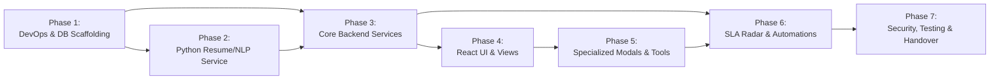

# TalentOS — Master Implementation Plan & Phase-Wise Work Distribution

This document defines the phase-by-phase implementation roadmap to transform the single-file **TalentOS** prototype (`it-recruitment-crm-platform-non-ai.html`) into a robust, enterprise-grade production platform across three repositories with one-click Docker Compose containerization.

---

## Technical Stack Distribution

| Layer | Technology | Repository Name |
| :--- | :--- | :--- |
| **Backend API** | Node.js (v20+), TypeScript, Express/Fastify, Prisma ORM, Nodemailer, Zod | `talentos-backend` |
| **Frontend Web** | React 18/19, TypeScript, Vite, Tailwind CSS, TanStack Query, Lucide Icons | `talentos-frontend` |
| **Resume & NLP Engine** | Python 3.11+, FastAPI, Uvicorn, pdfplumber, python-docx, spaCy / Regex, Pydantic | `talentos-resume-parser` |
| **Database** | PostgreSQL 16 (In-House Docker or External Cloud via `DB_LOCATION`) | Orchestrated via Docker |
| **Email Service** | SMTP via Nodemailer (Configured via `.env`) | Internal Backend Service |
| **DevOps / Orchestration** | Docker Compose, Docker Multi-stage Builds, Shell Scripts, Makefile | Root Workspace |

---

## Phase Overview Roadmap

---

## Phase 1: Infrastructure, Multi-Repo Scaffolding & DevOps

> **Primary Focus:** Establishing repo scaffolding, Docker Compose orchestration, PostgreSQL database containerization with `DB_LOCATION` dynamic routing, and Prisma migration setup.

### Tasks & Deliverables
1. **Repository & Directory Initialization:**
   - [ ] Initialize Git repositories: `talentos-backend`, `talentos-frontend`, and `talentos-resume-parser`.
   - [ ] Configure root orchestrator with `docker-compose.yml`, `.env.example`, and developer `Makefile`.
2. **Dual-Database Environment Routing:**
   - [ ] Implement `DB_LOCATION` variable in `.env` (`in_house` vs `external`).
   - [ ] Configure Docker Compose `profiles: [in_house]` so the local PostgreSQL container only spawns when `DB_LOCATION=in_house`.
   - [ ] Write dynamic database URL resolver in `talentos-backend/src/config/prisma.config.ts`.
3. **Database Schema & Prisma Setup:**
   - [ ] Deploy `schema.prisma` containing all 15 models, relations, enums, and indexes.
   - [ ] Write initialization script `scripts/init-db.sh` for in-house database setup.
   - [ ] Create database seed script (`prisma/seed.ts`) pre-populating prototype mock records:
     - 6 agency team users (Johnathan Miller, Marcus Brody, Sarah Jenkins, etc.).
     - 6 initial consultants across various work authorizations and stages.
     - 3 enterprise clients (Pfizer, Capital One, Delta Air Lines) and primary contacts.
     - 2 staffing vendors (Apex Talent Solutions, Synapse Infotech).
     - 3 active billable placements with margin spreads.
     - 6 default automation rules and SLA settings.
     - Master taxonomy options and 8 prototype custom fields.
4. **SMTP Email Configuration:**
   - [ ] Configure Nodemailer transporter in backend with verify-connection startup check.
   - [ ] Implement retry handling and error logging to the `EmailLog` table.

### Acceptance Criteria
- Running `docker compose up --build` launches the entire ecosystem with zero manual intervention.
- Changing `DB_LOCATION=external` bypasses the local PostgreSQL container and successfully connects to external RDS/Cloud SQL instances.
- Prisma seed script runs cleanly and populates all prototype sample records.

---

## Phase 2: Python Resume & Requirement Intake Microservice

> **Primary Focus:** High-speed, rule-based and NLP extraction of candidate resumes and client job order emails using FastAPI.

### Tasks & Deliverables
1. **FastAPI Microservice Setup:**
   - [ ] Build `talentos-resume-parser` Docker container on Python 3.11-slim.
   - [ ] Configure Pydantic schemas for request validation and standardized JSON outputs (`ParsedCandidateResponse`, `ParsedRequirementResponse`, `SkillMatchResponse`).
2. **Document Parsing Engine:**
   - [ ] Implement `parsers/pdf_parser.py` using `pdfplumber` to extract clean text while preserving section layouts.
   - [ ] Implement `parsers/docx_parser.py` using `python-docx` for `.docx` word documents.
   - [ ] Implement UTF-8 plain text sanitizer for pasted snippets.
3. **Information Extraction Modules:**
   - [ ] **Contact Extractor:** Phone numbers (US/Intl formats) and validated corporate/personal email addresses.
   - [ ] **Work Authorization Detector:** Pattern matcher for US Citizen, Green Card, H-1B, C2C Subcontractor, W2 Hourly, TN Visa, OPT/CPT.
   - [ ] **Skillset & Competency Extractor:** Normalized taxonomy dictionary matching 250+ tech skills (AWS, Kubernetes, Snowflake, Java, PySpark, Python, Terraform, etc.).
   - [ ] **Education & Experience Extractor:** Degree level (Master's, BS, Ph.D.) and job history timeline calculations.
4. **Client Email Intake Parser:**
   - [ ] Endpoint `POST /api/v1/parse-email` extracting client company name, job title, location/work model, hiring manager name, skills required, and missing notes.
5. **Skill Matcher Algorithm:**
   - [ ] Endpoint `POST /api/v1/match-skills` comparing candidate bench profiles against job requisitions with match scoring (e.g., 94% Match, 88% Match).

### Acceptance Criteria
- Multipart resume uploads (`.pdf`, `.docx`) return structured profile JSON within 600ms.
- Email intake parser matches prototype samples (Goldman Sachs, Pfizer, Capital One).
- Healthcheck endpoint `/health` integrated into Docker Compose readiness checks.

---

## Phase 3: Core Backend APIs, Security & Rate Masking

> **Primary Focus:** Core business logic, secure JWT authentication, granular RBAC, financial rate-masking layer, and RESTful APIs.

### Tasks & Deliverables
1. **Authentication & Role-Based Permissions:**
   - [ ] Secure JWT authentication (short-lived access tokens + rotating refresh tokens stored in DB).
   - [ ] Role-Based Access Control (RBAC) middleware verifying 6 agency roles.
2. **Financial Rate-Masking Middleware:**
   - [ ] Interceptor middleware inspecting `req.user.rateMasked`.
   - [ ] Dynamically masks `hourlyRateW2`, `hourlyRateC2c`, `billRate`, `payRate`, `hourlySpread`, and `marginPct` for restricted recruiters.
   - [ ] Ensures financial data is never leaked in JSON network responses when rate masking is enabled.
3. **Domain REST Controllers & Services:**
   - [ ] **Candidates API:** Full CRUD, search, filter by work auth and stage, link uploaded resumes.
   - [ ] **Clients & Contacts API:** Client directory, contact cards, linked active requisitions and placements.
   - [ ] **Vendors API:** Vendor profiles, Net 30/45 terms, invoicing cycles, MSA/COI compliance dates.
   - [ ] **Requirements API:** Job order creation, status transitions (`Requirement` &rarr; `Submitted` &rarr; `Interview` &rarr; `Selected` &rarr; `Onboarding`).
   - [ ] **Submissions API:** Candidate submittals, pitch email drafting, feedback SLA tracking.
   - [ ] **Placements Ledger API:** Billable placements, margin calculations, SOW extensions.
   - [ ] **Custom Fields & Taxonomy API:** Dynamic field definitions and master dropdown categories.
4. **Data Import & Migration Service:**
   - [ ] CSV streaming parser for bulk candidate migration with dynamic column-mapping validation.
5. **Resume Parser Service Integration:**
   - [ ] HTTP service wrapper connecting the backend to `http://resume-parser:8000`.

### Acceptance Criteria
- 100% of prototype entities supported via REST endpoints with Zod DTO validation.
- Rate masking prevents unauthorized users from inspecting billing numbers via DevTools network responses.
- CSV import accurately parses and saves 1,000+ candidates in under 3 seconds.

---

## Phase 4: Frontend Development & UI Porting

> **Primary Focus:** Building the React SaaS web app matching the visual styling, theme, and component structure of the prototype.

### Tasks & Deliverables
1. **Frontend Architecture & Theme Setup:**
   - [ ] Initialize React + Vite + TypeScript project.
   - [ ] Configure Tailwind CSS matching prototype colors (`brand-50` to `brand-950`, `sidebar` dark theme, Plus Jakarta Sans font, JetBrains Mono for code/rates).
   - [ ] Setup Axios client with token refresh interceptors.
2. **Application Shell & Navigation:**
   - [ ] **Sidebar Component:** Responsive navigation covering all 10 views with active state indicators and pill counters.
   - [ ] **Topbar Component:** Global search bar, SLA priority bell with badge, active role switch selector, user avatar dropdown, sign-out modal.
   - [ ] **Toast System:** Smooth notification banners with icons matching prototype toast behavior.
3. **Core View Implementations:**
   - [ ] **Dashboard (`/dashboard`):**
     - Metric cards: Active Requisitions, Submissions, Interviews, Placements, Monthly Gross Profit, Avg Spread, Margin %, Expiring Contracts Radar.
     - Active Requisitions table with status filter, quick submit dropdown, and bench picker.
   - [ ] **Recruitment Pipeline (`/pipeline`):**
     - Dual-view toggle: Kanban Board and Table View.
     - 5 stages: Requirement, Submitted, Interview, Selected, Onboarding.
     - Drag-and-drop or 1-click stage advancement with automated placement triggers.
   - [ ] **Consultant Directory (`/consultants`):**
     - Candidate bench cards, work authorization badges, rate display with rate-masking support.
     - Quick resume preview drawer and download links.
   - [ ] **Client Directory (`/clients`):**
     - Company overview, primary contact cards, tabs for Open Requisitions and Active Placements.
   - [ ] **Staffing Vendors (`/vendors`):**
     - Subcontractor directory, payment terms, MSA verification badges, contact information.
   - [ ] **Billable Placements (`/billable`):**
     - Placement ledger, financial spread chips, 30-day expiration badges, SOW contract extension modal.
   - [ ] **User Management (`/user-management`):**
     - Team roster, desk assignment, workload metrics, 1-click rate-masking toggle, invite member modal.
   - [ ] **Custom Fields & Taxonomy (`/custom-fields`):**
     - Custom field management across 5 entities, master configurable dropdowns editor.
   - [ ] **Data Import (`/import-data`):**
     - Interactive CSV column mapper, preview table, template download.

### Acceptance Criteria
- UI matches the design, typography, spacing, and micro-interactions of `it-recruitment-crm-platform-non-ai.html`.
- Global search filters across all entities instantaneously.
- Rate masking obscures all sensitive dollar figures across the UI when toggled.

---

## Phase 5: Specialized Modals & Workspaces

> **Primary Focus:** Implementing interactive tools and modal wizards directly ported from the prototype.

### Tasks & Deliverables
1. **Interactive Resume Parser Modal:**
   - [ ] Drag-and-drop resume upload zone (PDF, DOCX).
   - [ ] Sample loader buttons (Anand Verma, Meera Krishnan, Tarun Sengupta).
   - [ ] Parsing progress bar with simulated stage transitions.
   - [ ] Extracted draft profile review form with 1-click approval into the candidate roster.
2. **Requirement Intake Email Parser Modal:**
   - [ ] Raw client email text input box with sample loader buttons (Goldman Sachs, Pfizer, Capital One).
   - [ ] Pattern extractor displaying company, role, location, hiring contact, skills, and missing requirement notes.
   - [ ] 1-click approval creating an active job order in the pipeline.
3. **Bench Skill Matcher Modal:**
   - [ ] Compares requirements to all bench candidates, generating match score badges (>90%, >80%).
   - [ ] 1-click candidate submittal linking the candidate to the requisition.
4. **Submission Pitch Writer Modal:**
   - [ ] Tone switcher (`Professional`, `High-Impact`, `Technical Focus`).
   - [ ] Generates candidate client pitch drafts with candidate highlights.
   - [ ] 1-click copy to clipboard and direct email dispatch via SMTP.
5. **1-Click Placement Activation Wizard:**
   - [ ] Automated form linking requirement, candidate, client, and vendor.
   - [ ] Live calculation of Hourly Spread ($\text{Bill} - \text{Pay}$) and Margin \%.
   - [ ] Activates placement in billable ledger, shifts requirement to `Onboarding`, and logs to audit ledger.
6. **Universal Quick-Add Modal:**
   - [ ] Fast addition tabs for Candidate, Requirement, Client, Vendor, and Placement.

### Acceptance Criteria
- All 6 interactive modals fully operational and connected to backend REST APIs.
- Margin spread calculations match prototype values exactly.

---

## Phase 6: SLA Radar, Workflow Automation Engine & SMTP Alerts

> **Primary Focus:** Background cron scheduling, deterministic SLA scanning, rule automation builder, and automated SMTP email dispatch.

### Tasks & Deliverables
1. **Universal SLA Drawer & Priority Queue:**
   - [ ] Slide-out SLA drawer categorizing actionable items:
     - *Awaiting Feedback (>48h)* &rarr; Action: Open Submission Pitch Writer.
     - *Interview Today* &rarr; Action: Dispatch Candidate Prep Checklist.
     - *Stale Requirement (>5d zero submissions)* &rarr; Action: Run Skill Matcher.
     - *Contract Expiring (<30d)* &rarr; Action: Open SOW Extension Wizard.
     - *Compliance Watch (<60d visa expiry)* &rarr; Action: Compliance Task.
   - [ ] Task completion toggle and dynamic counter badge in topbar.
2. **Workflow Automation Rules Engine:**
   - [ ] Rule builder with visual canvas summary and trigger thresholds.
   - [ ] Pre-configured templates (Client Feedback Follow-Up, Same-Day Interview Checklist, Stale Req Alert, Contract Expiry Radar, High-Margin Placement Reward).
   - [ ] Live trigger simulator button ("Test Trigger") verifying execution.
3. **Automation Audit Log Ledger:**
   - [ ] Real-time audit history logging rule name, target, conditions met, action dispatched, and status (`Executed`, `Failed`).
4. **SMTP Outbox Engine:**
   - [ ] Email templating engine generating responsive HTML emails for:
     - Candidate follow-up pitches to clients.
     - Recruiter interview briefing checklists.
     - Contract expiration warnings to account managers.
   - [ ] Logs all transmissions in `EmailLog` table.

### Acceptance Criteria
- Background evaluation job runs without memory leaks.
- Outbound emails deliver cleanly via configured SMTP credentials.
- Audit log records all automated actions with accurate timestamps.

---

## Phase 7: Testing, Security Hardening & Production Handover

> **Primary Focus:** Security audits, container optimization, end-to-end testing, and production documentation.

### Tasks & Deliverables
1. **Security & Compliance Audits:**
   - [ ] Verify rate masking cannot be bypassed via direct API manipulation.
   - [ ] SQL injection and XSS sanitation testing.
   - [ ] JWT token revocation and refresh lifecycle tests.
2. **End-to-End Testing:**
   - [ ] Automated integration test suite covering the entire recruitment lifecycle:
     *Resume Upload* &rarr; *Candidate Extraction* &rarr; *Job Intake* &rarr; *Skill Match* &rarr; *Submission* &rarr; *Interview* &rarr; *Placement Activation* &rarr; *Billable Ledger Margin Lock*.
3. **Performance & Container Optimization:**
   - [ ] Multi-stage Docker builds reducing image sizes (<150MB for frontend, <200MB for backend, <350MB for python parser).
   - [ ] Nginx compression and static asset caching for frontend.
4. **Documentation & Operational Runbooks:**
   - [ ] Finalize `README.md` with one-command launch instructions.
   - [ ] Document database backup/restore procedures for both in-house Docker and external cloud databases.

### Acceptance Criteria
- `docker compose up` starts all 3 services healthy and connected in under 45 seconds.
- Test suite passes with >85% code coverage.
- Zero open critical security vulnerabilities.

---

## Summary Work Breakdown & Effort Matrix

| Phase | Description | Key Services | Estimated Dev Days |
| :---: | :--- | :--- | :---: |
| **Phase 1** | Scaffolding, DevOps, Docker & Dual-DB Routing | DevOps / Root / Prisma | 3 Days |
| **Phase 2** | Python Resume & Email Intake NLP Parser | `talentos-resume-parser` | 5 Days |
| **Phase 3** | Core Backend APIs, RBAC & Rate Masking | `talentos-backend` | 7 Days |
| **Phase 4** | React Frontend & View Implementations | `talentos-frontend` | 8 Days |
| **Phase 5** | Specialized Modals, Matchers & Wizards | `talentos-frontend` + Backend | 5 Days |
| **Phase 6** | SLA Radar, Automation Engine & SMTP Service | Backend + Jobs + SMTP | 5 Days |
| **Phase 7** | Testing, Security Hardening & Documentation | Full Stack / QA | 4 Days |
| **Total** | **Complete Platform Delivery** | **3 Repositories** | **37 Days** |

